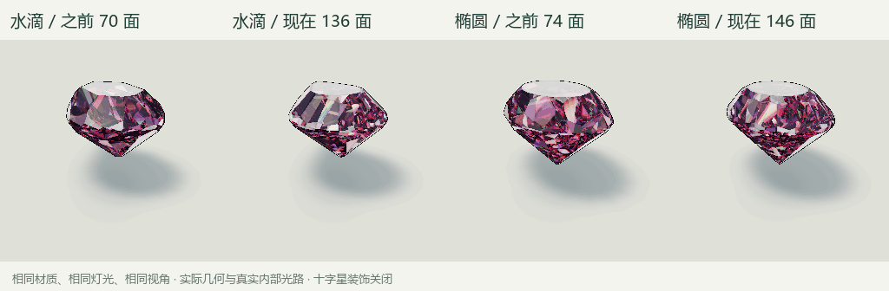

# 水滴形与椭圆形的精细切面

实现日期：2026-11-09，Blender 4.2.3 / Godot 4.6.1。当前启动展示粉色水滴形，可在右上角切型菜单切换椭圆。模型与旧材质共用相同内部光路和摄影棚，变化来自切面布局与轮廓。



## 几何变化

| 切型 | 旧面数 | 新面数 | 冠部 | 腰部 | 亭部 | 台面／底尖面 |
| --- | --- | --- | --- | --- | --- | --- |
| 水滴形 | 70 | 136 | 27 → 57 | 18 → 32 | 24 → 46 | 1 / 0 |
| 椭圆形 | 74 | 146 | 32 → 64 | 16 → 32 | 24 → 48 | 1 / 1 |

椭圆保留原有的长宽比例与大致冠高／亭深，采用更多交错的主冠面、星形面、上腰面、主亭面与下腰面。星形面的支撑位置向内调整，使它们在更密的方位角下仍能形成真正的平面，台面也相应收敛。水滴轮廓由同一组 Bézier 曲线更密地采样，保留左右镜像对称，细化圆肩与尖端附近的轮廓。凸体求交只保留实际形成表面的支撑面；尖端约束使水滴的有效分面数与椭圆不同。

这些都是不同法线的真实平面，没有把同一平面三角化来增加计数。光线会撞到新增切面、改变折射和全内反射路径。模型仍是闭合凸体，Blender 保存平面法线；GLB 与 JSON 由同一配方生成。地面焦散也使用同一组新平面。

这两种 GLB 关闭 Godot 自动 LOD 简化，缩小时继续保留全部切面，避免显示表面与光学平面在不同细节级别下分离。其余切型的导入设置保持原样。

二维外轮廓与旧模型的栅格交并比约为水滴 0.986、椭圆 0.981；体积变化分别约为 −4.3%、−5.2%。这些变化来自新的冠亭切面和更平顺的腰部，保持原有外形识别与整体比例。

## 资料与设计范围

[GIA 椭圆说明](https://4cs.gia.edu/en-us/blog/oval-cut-diamond-guide/)用于参考椭圆轮廓、对称性和明亮式切面家族；[GIA 水滴说明](https://4cs.gia.edu/en-us/blog/pear-shaped-diamond-tips-picking-perfect-one/)用于参考肩部、侧翼、尖端与台面对称。项目中的 136／146 面包含腰部及额外冠亭分面，是适合像素展示的原创美术切型，不是工业切磨图纸、GIA 标准面数或评级结论。

当前摄影棚中的暗区与亮条让切面产生明暗对比；没有模拟真实观察者头肩遮挡，因此不能将某个视角的暗面直接解释为实物钻石的蝴蝶结评级。没有针对暗切面添加强制填亮或换用另一套材质。

## 容量与文件

可见宝石和地面前向光线追踪均提升到最多 192 个不同平面，共用 `shaders/optics_limits.gdshaderinc`。Godot 加载门限和 Blender 导出门限同步提升；三种圆润外形继续使用解析求交。面数增加会增加相关光线求交的成本，性能记录包含实际渲染完成后的图像读回和窗口等待。

- `assets/gem/cuts/pear.blend/.glb/.json`、`oval.blend/.glb/.json`：可编辑源模型、实际渲染模型与光学数据。
- `tools/cut_geometry.py`：32 段轮廓与细分冠亭配方，`recipe_version = 2`。
- `tools/build_cuts.py`：支持只更新指定切型。
- `scripts/cut_detail_checks.gd`、`tools/check_cut_detail.py`：真实转台与几何／画面对比。
- `artifacts/cut_refinement_before/`：修改前模型、配方、哈希与真实旋转帧；已有基准不会被再次捕捉覆盖。

只重建本轮两种切型：

```powershell
& 'D:\Program Files (x86)\blender\blender.exe' --background --factory-startup --python tools/build_cuts.py -- --cuts pear oval
```

本轮验证其余十种外形的 `.blend`、`.glb`、`.json`、图标哈希均保持不变。

## 验证

运行 `Godot --path . --audio-driver Dummy -- --qa-cut-detail`，然后 `python tools/check_cut_detail.py`。

检查闭合流形、Euler 特征、凸性、各平面有效面积、镜像对称、轮廓与体积变化，以及 GLB 导入后每个顶点与光学平面的一致性。粉色／无色各捕捉两种切型的 60 帧转台，参数、灯光与视角与修改前完全相同，关闭附加十字星。两种外形还覆盖十类材质和两种照明，共 40 个组合，并分别测试多次反射、色散、地面焦散和暂停后的逐像素稳定性。

亮点指标统计局部邻域中有足够明暗差的小峰值，将连成一片的同亮度像素计为一个特征，排除外轮廓和大块纯白台面。它是图像细节指标，不是实物亮度或火彩评级。当前转台里，粉色水滴的平均局部亮特征约 174 → 192，粉色椭圆约 213 → 247；无色版本也有增加，高光峰值保留。各项结果保存在 `artifacts/cutdetail_checks.json`。

既有材质和地面检查同步运行；旧图片中水滴／椭圆的固定像素对照由本轮几何对照替代，未改外形继续做原有回归。
