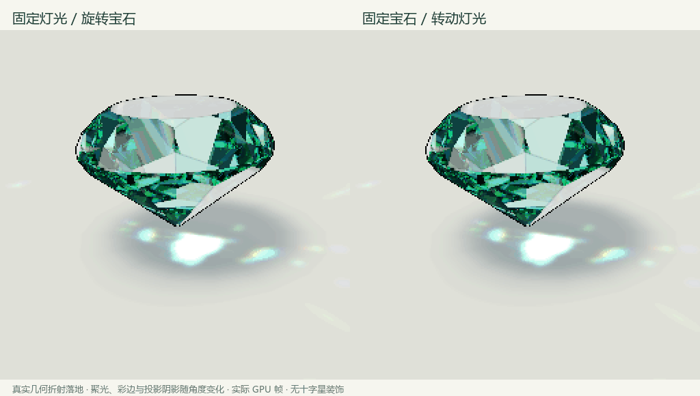

# 地面焦散与柔和阴影

实现日期：2026-11-09，Godot 4.6.1 / Compatibility / OpenGL 3.3。运行 `build/PRISM.exe`，默认展示细化后的粉色水滴形。展开“光效微调”可调整地面焦散、阴影柔和度和灯光方向。空格暂停宝石后拖动灯光方向，观察焦散与阴影移动；切换切型、倾斜宝石也会改变地面结构。

## 折射焦散

旧版用几块重叠椭圆色块表现光斑。现在从一个上方摄影棚光源发射固定 56×56 采样网格，每个样本分别计算 RGB 三个折射率。光线进入当前切型的实际凸多面体，或解析椭球／截半椭球，执行 Snell 折射、Schlick 近似 Fresnel、沿程吸收，最多六次界面交互处理全内反射。第一次成功透射且向下传播时，与地面求交，得到沉积位置与透射能量。

相邻两条光线的落点差用于估计光束的椭圆足迹，再用有界 Gaussian 核进行加法累积。足迹变窄、光束重叠时聚成亮纹，RGB 路径差异形成彩边。采样网格不读取时间噪声，姿态与灯光固定时画面不自行闪烁。宝石浮动高度也参与落地位置计算。

光源的方位角与界面灯光方向一致；为让焦散保留在陈列区域，高度方向使用单独的上方摄影棚光源，没有将原有材质里的每块环境灯箱逐一重建。顶点着色器完成前向求交，地面上的小面片沉积光能，正常深度测试使其被宝石遮挡。相机仍使用原有低分辨率 SubViewport 和最近邻放大。

普通单色与分区宝石采用当前折射率、色散、吸收和体色；分区在各光程段中点采样。变石使用对应日光／暖灯的代表透射色，未执行完整逐波长地面光谱积分。水晶欧泊、猫眼、月光石按配方减弱沉积光能；珍珠与黑欧泊的不透明底体不投射透明焦散。未将欧泊变彩、珠光、纤维眼线或月光层理继续传播到地面。

这是实时近似：只取首次成功透射，未分裂并追踪每次 Fresnel 反射后的全部路径；也未计算波动干涉、完整多次散射或多个有限面积光源。足迹宽度、能量和最远落点进行了适合像素展示的约束。

## 阴影

刻面模型的三维顶点按当前旋转、倾斜、高度与地面光源方向投影到地面，求二维凸包，生成支撑平面。圆润模型使用缓存的解析表面采样形成投影轮廓。地面着色器在轮廓边缘形成可调半影，并叠加轻微、宽柔的环境遮蔽。光源转动改变投影方向，姿态变化改变轮廓。

阴影柔和度默认 65%。边缘宽度也随宝石悬浮高度变化；透明材质的阴影保留透光感，不透明材质遮蔽较强。该阴影不是把每条被吸收的光线统计成遮蔽，也不是完整面积光源可见性积分。

## 文件与验证

- `scripts/ground_optics.gd`：采样面片、参数同步、投影轮廓、材质透射系数。
- `shaders/caustic_photons.gdshader`：前向折射、吸收、全内反射、落地与能量沉积。
- `shaders/floor.gdshader`：阴影、半影与环境遮蔽。
- `scripts/ground_checks.gd`、`tools/check_ground.py`：真实 GPU 场景与图像检查。
- `tools/qa_masks.py`：独立白色几何轮廓掩码，用于隔离地面变化与宝石像素。

运行 `Godot --path . --audio-driver Dummy -- --qa-ground` 后执行 `python tools/check_ground.py`。检查包括 12 外形 × 两种照明、10 种材质、固定灯光旋转宝石与固定宝石旋转灯光各 60 帧；每帧配套关闭焦散的参考，确保变化来自地面折射光，材质反光变化不能单独通过检查。另检查折射率、色散、焦散强度、阴影柔化、灯光／倾斜投影和静态逐像素稳定性。

不透明材质开关焦散的画面必须完全相同。其他材质需要可见落地能量；色散增加彩边。独立无光照白色几何掩码用于确认焦散不会覆盖宝石，并与修改前的宝石像素对比。

性能记录包含 GPU 完成后的图像读回，保存为 `render_readback_ms_median/p95`，不是仅测 CPU 提交绘制的耗时，也不等同于用户窗口固定帧率。材质专项测试关闭地面焦散以隔离宝石光学，地面专项验证完整组合。

实现使用 Godot 官方的 [ArrayMesh](https://docs.godotengine.org/en/stable/classes/class_arraymesh.html)、[空间着色器](https://docs.godotengine.org/en/stable/tutorials/shaders/shader_reference/spatial_shader.html) 和 [GeometryInstance3D](https://docs.godotengine.org/en/stable/classes/class_geometryinstance3d.html) 接口。
