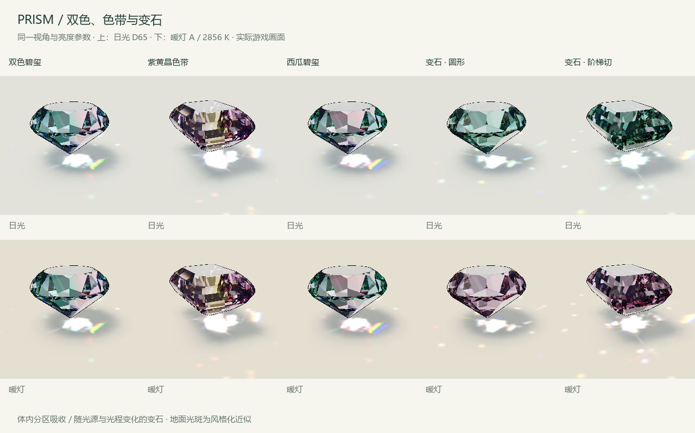

# 第一批特殊材质：双色、色带与变石

实现日期：2026-11-09。Blender 模型和九种切型继续共用已有的内部反射计算；没有重新建模。

## 试玩

运行 `build/PRISM.exe`。左侧选择双色碧玺、紫黄晶色带、西瓜碧玺或变石，点击日光／暖灯，或按 L 切换。建议先暂停旋转，再来回切换灯光，以便比较同一组切面的变化。

- 双色碧玺：绿／粉两区，调整交界位置、柔和度和方向，两种颜色可自定义。
- 紫黄晶色带：紫色基体与中央金色色带，色带位置和方向可调。这是展示分区机制的造型预设，并非每块天然紫黄晶的生长形态。
- 西瓜碧玺：粉色核心与绿色外圈，范围滑块调整核心半径；方向滑块停用。
- 变石：日光下蓝绿，暖灯下紫红；颜色浓度影响每条光程的透射量。表面抛光反光仍随照明显示较中性的亮色。
- 单色宝石：保留六种原有配色与自选颜色，数字 1—6 会切回对应单色。

切换切型保留材质、照明、分区参数和自定义分区颜色。不同切型有不同的包围尺寸，分区坐标据此归一化。切换材质会载入该材质的两色与折射参数；分区位置、方向、柔和度和照明继续保留。所有色区固定在宝石本身的坐标中。



## 分区吸收

内部每一段光线都有起点、终点和长度。以局部归一化坐标定义生长分区，得到该段在两种吸收系数中的平均权重，再按 Beer–Lambert 定律乘上透射率。颜色既可能来自当前可见区域，也可能来自内部反射后穿过的另一色区。

平直界面使用 smoothstep 的分段原函数求平均，能处理跨区与接近边界的光线。条带是两个平直界面之差。径向色壳每段取四个空间样本，属于实时近似，在较薄的壳层或掠射角下可能出现离散误差。现有凸体支持的最多十次反射交互与三个折射色带继续有效。

## 变石与照明

离线生成 1024 × 2 的 RGBA32F 线性透射表，横轴为累计光程，两个数据行分别对应 CIE D65 和 CIE A（2856 K）。表格从 360–830 nm 的 CIE 1931 2° 匹配函数与光源数据积分而来，使用 Bradford 色适应统一到显示器 D65 白点，再裁剪到显示 RGB 的非负范围。全波长积分在构建阶段完成；运行时仍追踪三个折射色带，每个色带用自己的累计光程查询该表。

吸收函数采用黄色与蓝紫波段的平滑吸收峰，留下不同的透射窗口，针对当前像素画面调整了参数。它是模拟变石观感的近似，未使用某块真实变石的实测吸收谱，也不包含晶轴多色性或偏振。

反射分支的能量权重与吸收分开累计；每次出射的贡献按该路径累计长度应用光谱透射，避免重复吸收。浓度改变实际的等效光程。照明切换同时更新变石的光谱行、摄影棚的轻微暖色、地面与代表性透射色。可见色变由照明驱动，时间只驱动旋转与原有闪光。

地面光斑仍使用已有的风格化程序图案。双色材质使用两区颜色，变石取一条代表光程的透射色；没有计算完整的地面光子焦散。当前白炽灯模式也不代表所有暖色 LED 的光谱。

重建透射表：

```powershell
python tools/build_alexandrite_lut.py
```

所需数据已保存在 `tools/spectral_data/`，无需联网；除 NumPy 外无需色彩科学库。`assets/materials/alexandrite_transmittance.json` 记录数据尺寸、来源和代表性光程的线性 RGB。

## 数据来源与授权

CIE 匹配函数与光源表取自 [pbrt-v4 的 spectrum.cpp](https://github.com/mmp/pbrt-v4/blob/master/src/pbrt/util/spectrum.cpp)，保留原文件和 Apache-2.0 许可。构建包附 `PBRT_LICENSE.txt` 与 `THIRD_PARTY_NOTICES.txt`。对应的 CIE 官方数据说明：[1931 2° 匹配函数](https://cie.co.at/datatable/cie-1931-colour-matching-functions-2-degree-observer)、[D65](https://cie.co.at/datatable/cie-standard-illuminant-d65)。材质性质的 GIA 来源见原调研文档。

## 验证

GPU 检查覆盖四种材质 × 两种灯光 × 九种切型，共 72 个组合，并从实际输出像素检查：每种切型的变石在日光下绿通道高于红通道、在暖灯下红与蓝通道高于绿通道；分区同时保有两种颜色；位置／方向／柔和度和变石浓度调整会改变画面。检查时关闭装饰性十字星，固定视角和时刻。

`artifacts/material_checks.json` 保存结果，`artifacts/material_comparison.png` 直接拼接游戏截图，未对宝石画面调色。原有 54 个单色组合、几何、反射深度、火彩、旋转与光斑检查继续保留。
