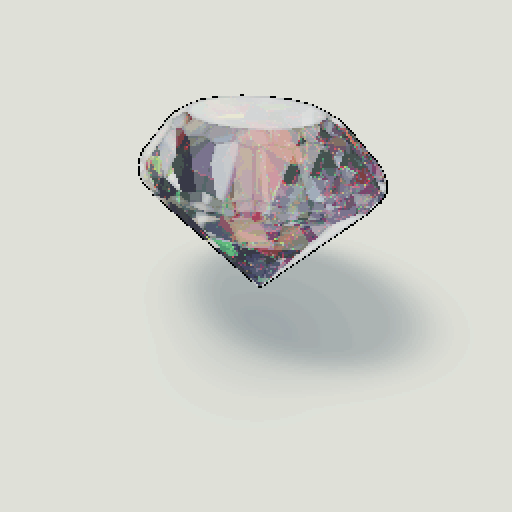
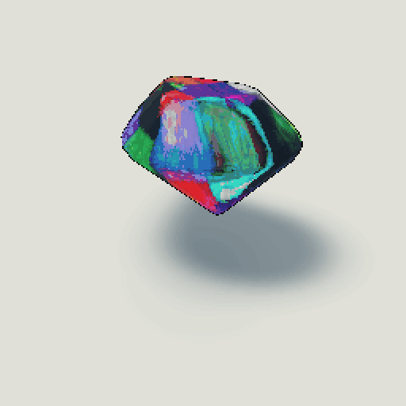

# 欧泊：水晶欧泊与黑欧泊

实现日期：2026-11-09。运行于 Godot 4.6.1 Compatibility / OpenGL 3.3。最初使用九种刻面切型，随后扩展为也可使用圆珠、椭圆珠和椭圆弧面；几何扩展见 [圆润外形说明](rounded_materials.md)。

## 试玩

运行 `build/PRISM.exe`，在材质菜单选择水晶欧泊。拖动宝石观察彩斑变化；按空格暂停旋转，再拖动“灯光方向”滑块，可以固定宝石单独改变照明。L 继续切换日光／暖灯。

- 彩斑大小：调整可见晶域的空间尺度，不改变微结构的纳米间距。
- 变彩亮度：调整衍射彩光，0 可观察关闭变彩后的透明基体。
- 乳浊程度：0 偏清透，较高数值产生柔和的体内朦胧感。
- 灯光方向：与“光效微调”中的方向参数同步，同时影响摄影棚反光和欧泊彩斑。

上述设置会在换切型以及暂时切换其他材质后保留。水晶欧泊与黑欧泊分别保存彩斑大小、变彩亮度和乳浊程度。水晶欧泊保留内部反射与十字星开关；黑欧泊采用独立抛光高光与彩域细闪。

## 性质与实现选择

[GIA](https://www.gia.edu/opal-description) 将 crystal/water opal 描述为透明至半透明、具有变彩的欧泊；其变彩与有序微小二氧化硅球体对光的衍射有关。[澳大利亚博物馆](https://australian.museum/learn/minerals/gemstones/opal/) 还说明，局部排列的差异会形成不同的色区，色区随入射角变化。水晶欧泊因此适合作为本次“通透、彩斑、闪光”的目标。

本实现使用自制的、可平铺的 128³ RGBA8 三维参数场。512 个不规则 Voronoi 域具有各自的方向与层间距；数据存储方向和间距，没有预先画好的虹彩颜色。体内坐标按切型尺寸归一化，压缩深度方向的域变化，并施加轻微、固定的空间扰动。

渲染时，现有内部反射着色器沿三个折射色带追踪真实切面。在前两段光程中，各取三个浅层体积样本。每个样本读取域方向与间距，结合光线反方向（朝向观察者的内部路径）和两个摄影棚灯的局部方向计算响应。

局部主波长采用反射形式的 Bragg 关系作为近似：`lambda ≈ 2 n d |N · L|`。域法线与光照／观察半角向量的对齐控制彩斑显隐，较窄的响应形成短暂闪彩。主波长经平滑 RGB 谱色近似转成显示颜色。灯光随摄影棚方向旋转、域参数随宝石旋转；颜色不读取 `TIME`，没有整体循环色相。

微结构的方向和间距是美术参数，并非真实欧泊的扫描值。模型没有完整求解折射后的照明路径、波动干涉、偏振或多次散射；日光／暖灯对欧泊使用统一的摄影棚暖色近似，没有像变石那样逐波长积分其光源谱。此处的晶域描述局部有序结构，不表示欧泊本身是普通晶体矿物。

## 通透与闪光

基体保留折射、切面反射和光程吸收。乳浊参数增加内部衰减及柔和散射。欧泊透射的灯箱强度单独调低，使窄带彩光在清透底体中可读；表面抛光反射仍使用原有摄影棚亮度，所以可以同时看到白色高光与内部彩斑。

地面已升级为几何折射焦散；水晶欧泊减弱落地能量，黑欧泊不投射透明焦散。未将欧泊域内衍射变彩继续追踪到地面。刻面、珠形和弧面都可展示这两种欧泊。

## 黑欧泊配方

本轮加入独立黑欧泊材质，菜单切入时推荐水滴形。深色不透明底体与两个相近深度的彩层合成，变彩主色仍由域方向、间距和光照／观察方向计算。大彩斑使用最近邻方向采样，另用 128³ R8 平滑边界纹理控制边缘淡出，避免将相邻方向插值成碎彩边。域内细纹理只改变同一主色的明暗，较窄角度的响应增加细闪，外部白色抛光高光独立保留。

与水晶欧泊不同，黑欧泊不让十次内部镜面反射反复复制大色块；深色基体上的彩层更连贯。“乳浊程度”在该配方中控制彩层衰减，不会把深色基体变为透明玻璃。地面彩色光斑相应减弱。两种配方均为实时美术近似。

## 文件与重建

- `shaders/opal.gdshaderinc`：域参数采样、谱色近似、角度响应和浅层积分。
- `shaders/gem.gdshader`：欧泊分支与已有的透明内部反射。
- `assets/materials/opal_domains.bin`：8 MiB 三维参数数据，RGBA8、x 最快、其次 y、再 z。
- `assets/materials/opal_domains.json`：尺寸、固定随机种子、编码说明。
- `assets/materials/opal_domain_order.bin`：黑欧泊专用 2 MiB 边界衰减场，R8、相同体素顺序；原 RGBA8 场保持不变。
- `tools/build_opal_domains.py`：离线生成器，依赖 NumPy 与 SciPy；无需网络。
- `scripts/gem_stage.gd`：上传 ImageTexture3D、更新局部光源方向、保存参数。

重建参数场：`python tools/build_opal_domains.py`。相同随机种子会生成相同数据。Godot 的三维纹理接口见 [ImageTexture3D 官方说明](https://docs.godotengine.org/en/stable/classes/class_imagetexture3d.html)。

## 验证

运行 `Godot --path . --audio-driver Dummy -- --qa-opal`，随后 `python tools/check_opal.py`。

测试涵盖 12 种外形 × 两种照明的 24 个组合、72 帧转台、自定义参数保留、灯光滑块同步、彩斑大小与乳浊程度，以及暂停后静态画面逐像素一致。检查使用关闭附加十字星的真实 GPU 渲染。

为隔离变彩响应，在灯光 0°／90° 下分别捕捉正常欧泊与关闭变彩的参考。将各灯光下的参考扣除后，仍应看到明显的彩光差异；摄影棚反光自身的改变不能单独通过该项检查。各切型还必须具有足够的彩色像素与多个色相区域。

`artifacts/opal_checks.json` 保存图像指标，`artifacts/opal_qa_report.json` 保存功能结果，`artifacts/opal_comparison.png` 拼接实际截图。GIF 使用同一色板、最近邻放大和实际帧，不生成中间画面或给宝石另行调色。

黑欧泊使用 `--qa-refinement` 与 `tools/check_refinement.py`，覆盖 24 个形状／照明组合、60 帧旋转、连贯的同色块面积、灯光变化扣除无变彩参考后的彩光响应、大小滑块与静态稳定性；同时检查两种欧泊的设置分别保留。源码与导出程序均运行该检查。
