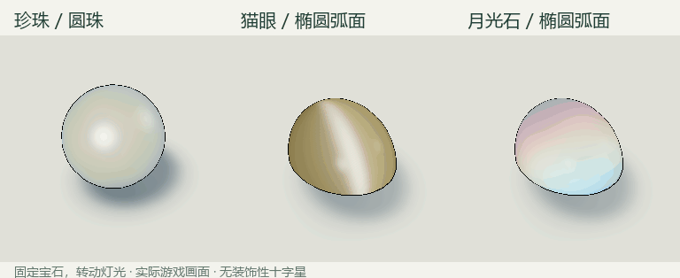
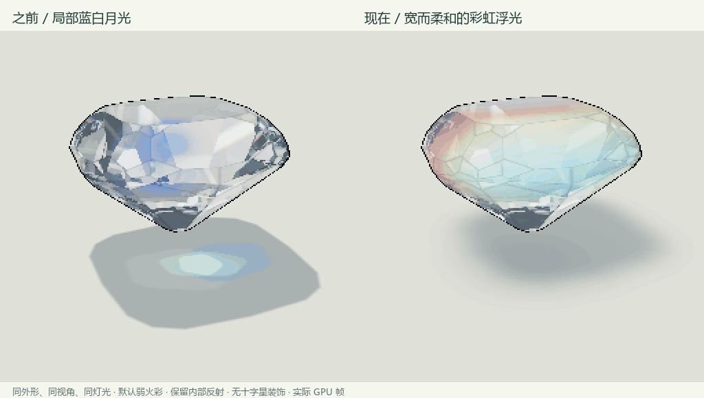
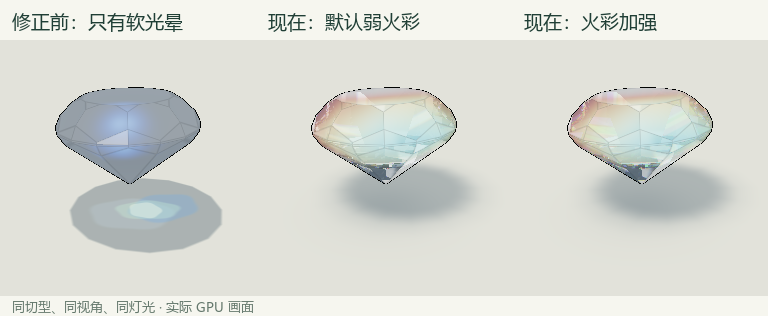
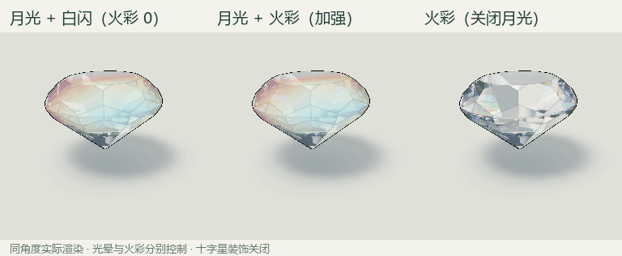

# 圆润外形与珍珠、猫眼、月光石

实现日期：2026-11-09。Blender 4.2.3 / Godot 4.6.1 / Compatibility。

## 外形选择

三者都适合圆润表面，但并不都需要完整球体。珍珠有圆形、椭圆与不规则形等多种形态；猫眼和月光石常以弧面切割展示光带或光晕。参考 [GIA 珍珠类型与形状](https://www.gia.edu/gia-news-research/differences-between-pearl-types)、[GIA 月光石切工说明](https://www.gia.edu/moonstone-quality-factor)、[GIA 特殊光学效应研究](https://www.gia.edu/gems-gemology/summer-2025-phenomenal-gemstones)。

本次新增三个原创、闭合的 Blender 模型：

| 外形 | 几何 | 推荐展示 |
| --- | --- | --- |
| 圆珠 | 完整光滑球面 | 珍珠的柔和光泽与晕彩 |
| 椭圆珠 | 完整光滑椭球 | 椭圆珍珠，也可演示其他材质 |
| 椭圆弧面 | 上半椭球与平底 | 猫眼、月光石，也适合水晶欧泊 |

切入珍珠时界面选择圆珠，切入猫眼或月光石时选择椭圆弧面；之后可以自由换外形，保留材质、体色、照明与参数。九种原有刻面和三种圆润外形均能使用已有材质。



## 珍珠

使用不透明的柔和散射底体、紧凑高光、较宽的光泽和淡淡的粉绿晕彩。薄层干涉近似根据局部层厚、观察方向与光照方向计算 RGB 相位；层厚的小幅空间变化固定在物体坐标中。

可调体色、珍珠光泽、粉绿晕彩与灯光方向。表面保持圆润，不使用钻石式透明切面内部映像，也不添加十字星。

[GIA 珍珠说明](https://www.gia.edu/pearl-description) 区分体色、伴色与部分珍珠的 orient。这里的 RGB 薄层响应是表现其观感的近似，没有完整模拟珍珠层的多层多次散射。

## 猫眼

以金绿猫眼为配色与外观参考。固定的局部纤维方向和折射后的观察／照明方向决定一条窄反光带，外围有较柔和的晕光；弧面让其成为可滑动的眼线。底体加入两侧明暗差别以提示奶与蜜的层次。调节纤维方向会改变亮带方向，眼线方向与纤维横向对应。

可调体色、亮度、宽度、纤维方向和灯光。当前加入适合宽摄影棚光源的聚焦修正，仍是定向反射的美术近似，没有逐根模拟针状内含物，也没有完整求解光束在弧面内的焦散。

## 月光石

将白色外层抛光反光与内部蓝白光晕分开计算。折射后的采样点位于表面之下，光晕随局部层理、照明／观察方向和采样深度变化，形成宽而柔和的浮光。固定的低频空间起伏给光晕少量云状变化，不读取时间循环变色。

可调体色、月光亮度、光晕范围、彩虹晕彩、浮光深度和灯光。层状结构的散射响应为近似，未进行真实长石层结构的波动或多次散射计算。

彩虹月光扩展采用连续的物体内层理坐标、折射后的浅层采样位置，以及观察／照明半角方向。相互重叠的宽 RGB 响应形成暖色—浅绿—蓝色的柔和带状浮光；冠部云状包络随受光方向移动，彩带不会固定在屏幕上，也不读取时间循环变色。光晕下的透射灯箱接受有界的中性与彩色薄雾调制，避免亮面冲白，同时继续保留原切面的内部映像。

新增“彩虹晕彩”，默认 85%；光晕范围默认 78%。彩虹晕彩为 0 时回到蓝白响应，配合范围 48% 可逐像素复现旧配方。这是面向参考观感的美术展示配方，没有使用天然样品实测光谱；彩虹浮光与折射色散火彩使用不同计算路径。

## 刻面上的光晕、闪光与火彩

光晕、反射造成的明亮闪光、色散形成的彩色火彩是不同的响应，可以组合。GIA 的月光石切工说明也指出刻面切割可增强明亮度；珍珠则主要表现珠光、伴色与晕彩。不能因为材质有特殊光学效应，就将其所有闪色统一称作色散火彩，也不能给所有材质套用相同强度。

上一版的月光石／猫眼直接返回柔和材质分支，刻面没有走共用的内部反射与色散。现在将三色带折射、Fresnel 和多次内部反射整理为共用光路，并在这两类材质的刻面版本中启用。材质响应分别输出底体与光晕／眼线；先混合清透光路和柔和底体，再叠加特殊响应。月光光晕会适当遮蔽其下明亮的透射灯箱，使蓝白光不会被白色反光淹没。

- 刻面火彩：与原“彩色火彩”控件同步，0 关闭色散，保留白色反射与材质光晕。
- 刻面通透度：在光效微调中，控制柔和底体与共用清透光路的比例。
- 月光亮度／眼线亮度：继续独立控制特殊响应，设为 0 后刻面仍可闪光、产生色散。
- 月光石弧面也支持宽柔彩虹光晕；弧面不加入刻面版本的强化色散。猫眼弧面保留原有柔和眼线。
- 珍珠：继续使用不透明底体与珠光／晕彩，未添加透明宝石的内部火彩。

默认火彩强度较克制，高值用于美术增强。控件数值不等于某一波段的实测折射率差，本实现未校准到某颗天然月光石的实测谱。当前启动展示细化后的粉色水滴形；手动从材质菜单切入月光石时仍推荐弧面，可再选择刻面。







## 光学几何

新模型每圈 96 段、48 个纵向分段，保持光滑外法线，弧面底部使用平法线。实际渲染仍是 Blender GLB 网格，内部求交使用同一组参数的解析椭球；弧面额外求解底平面。表面法线按椭球梯度计算，避免三角面片的明暗拼接。

因此这些曲面不需要将数千个三角面全部传入 192 平面数组。原有凸多面体仍使用原来的平面求交。圆润外形的几何检查会验证导入 GLB 顶点满足椭球方程或底面约束，不会仅因平面数组为空就判定通过。

取景在圆润外形上稍微抬高，便于看出弧面；俯视继续可用。地面已升级为几何折射焦散与三维投影阴影；珍珠不投射透明焦散，猫眼和月光石保留较弱透射焦散。弧面使用解析椭球／平底求交；详见 [地面光学说明](ground_optics.md)。

## 文件与重建

- `assets/gem/cuts/sphere.*`、`oval_bead.*`、`oval_cabochon.*`：`.blend`、`.glb`、解析参数 `.json` 与轮廓图标。
- `tools/build_smooth_forms.py`：轴长、中心、弧面定义及可重复的建模／导出流程。
- `shaders/soft_gems.gdshaderinc`：三种独立光学响应。
- `shaders/gem.gdshader`：解析椭球／平底求交与材质分支。
- `scripts/gem_stage.gd`：参数、局部光照、几何验证与外形切换。

```powershell
& 'D:\Program Files (x86)\blender\blender.exe' --background --factory-startup --python tools/build_smooth_forms.py
```

修改圆润形状时应编辑生成器的轴长／中心，并重新导出网格和解析参数。不能任意变形网格后继续使用原椭球求交；刻面导出脚本会对此拒绝导出。

## 验证与近似范围

`--qa-soft` 捕捉三种材质 × 12 种外形 × 两种照明的 72 个组合，并为推荐外形保存 60 个灯光角度。`python tools/check_soft_gems.py` 检查几何与参数保留、晕彩和光泽开关、眼线宽度与纤维方向、浮光深度、固定姿态的逐像素稳定性。

猫眼和月光石在两种灯光角度下均保存关闭对应效果的参考图。从实际输出中扣除参考后，再测量眼线／蓝光重心的移动，避免仅由表面高光位移造成误判。静帧与 GIF 均直接来自 GPU 渲染；GIF 只使用统一色板，不另行给材质调色。

既有检查扩展为 12 种外形的 72 个单色组合、96 个分区／变石组合和 24 个欧泊组合，并保留反射、火彩、光斑与像素放大检查。三种新材质均为实时外观近似，未使用具体样品的实测光学数据。

`--qa-fire` 和 `tools/check_facet_effects.py` 检查月光石／猫眼 × 12 外形 × 两种照明的 48 组开关对照，要求所有九种刻面都能看到由色散引起的颜色差别，并检查弧面不因火彩设置改变。月光石额外捕捉“仅保留光晕与白闪”“仅保留火彩”“两者都有”“同时关闭”四种组合，防止一项响应掩盖另一项缺失。多反射与单次反射的画面必须不同，通透度也必须真实改变底体。另存 60 帧旋转记录，全部关闭装饰性十字星。

`--qa-moon` 与 `tools/check_moonrainbow.py` 额外覆盖 24 个彩虹月光组合，分别验证光晕与火彩，要求暖、绿、冷色区各自形成连贯的大区域。默认光晕扣除无光晕参考后，可见范围比原局部蓝光更宽；固定姿态改变灯光时扣除各自参考，验证变化确实来自光晕。检查蓝白旧配方还原、控件同步与设置保留、范围／深度／通透度／反射次数、静态稳定性。60 帧前后转台使用相同切型、视角、灯光与默认弱火彩，未重新调色或生成中间帧。
